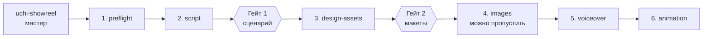

# uchi_showreel

Набор скиллов Claude для производства вертикальных брендовых роликов Учи.ру (9:16, 1080 × 1920, 60 fps): рилсы, эксплейнеры, моушен-ролики. Мастер-скилл запускает шесть этапов по порядку и останавливается на двух точках согласования с человеком.

## Как это работает



| № | Скилл | Задача | Выход |
|---|---|---|---|
| — | [`uchi-showreel`](skills/uchi-showreel/SKILL.md) | мастер: порядок запуска, состояние проекта, гейты | `state.json` |
| 1 | [`uchi-showreel-1-preflight`](skills/uchi-showreel-1-preflight/SKILL.md) | Remotion, ElevenLabs, шрифты, логотип, ffmpeg, сеть; режим `full` или `preview` | `00-preflight.json` |
| 2 | [`uchi-showreel-2-script`](skills/uchi-showreel-2-script/SKILL.md) | тема, факты, текст озвучки, раскадровка, 15 композиций текста | `script.md`, `storyboard.md`, `sources.md` |
| 3 | [`uchi-showreel-3-design-assets`](skills/uchi-showreel-3-design-assets/SKILL.md) | Figma-ассеты, палитра, шрифты, логотип, три ключевых кадра | `assets/`, `keyframes/` |
| 4 | [`uchi-showreel-4-images`](skills/uchi-showreel-4-images/SKILL.md) | изображения через API ElevenLabs | `images/`, `images-manifest.json` |
| 5 | [`uchi-showreel-5-voiceover`](skills/uchi-showreel-5-voiceover/SKILL.md) | озвучка ElevenLabs, звуки с лицензиями, `timing.json` | `audio/`, `timing.json` |
| 6 | [`uchi-showreel-6-animation`](skills/uchi-showreel-6-animation/SKILL.md) | Remotion, блюр-типографика, паттерны, переходы, проверка MP4 | `out/final.mp4` |
| + | [`uchi-svg-icons`](skills/uchi-svg-icons/SKILL.md) | SVG-иконки Учи.ру в коде, проверка палитры | `*.svg`, `*.png` |

## Проверка шрифтов

Перед этапами 3 и 6 `state.py` требует свежий `fonts-check.json` и отказывает, если шрифты не подходят. Нужны **Oceanic Grotesk Condensed ExtraBold** и **Factor A Regular** с полной кириллицей, файлы кладутся в `showreel/<slug>/assets/fonts/`.

```bash
python3 skills/uchi-showreel-1-preflight/scripts/check_fonts.py showreel/black-sea
```

Работать на временных шрифтах можно только с явного согласия человека: `state.py start <проект> <этап> --preview-fonts --by "..."`. Для проверки нужен `fonttools`.

## Точки согласования

- **Гейт 1** после этапа 2: человек утверждает текст озвучки и раскадровку.
- **Гейт 2** после этапа 3: человек утверждает макеты (ключевые кадры 9:16: хук, основная сцена, финал).

Состояние ведёт `skills/uchi-showreel/scripts/state.py`. Он не даёт начать этап, пока предыдущий не завершён и гейт не утверждён.

```bash
python3 skills/uchi-showreel/scripts/state.py init showreel/black-sea
python3 skills/uchi-showreel/scripts/state.py start showreel/black-sea preflight
python3 skills/uchi-showreel/scripts/state.py status showreel/black-sea
```

## Установка

Скопируйте папки из `skills/` в каталог скиллов Claude (в каждой есть `SKILL.md`). Мастер ссылается на подскиллы по именам, поэтому ставьте их вместе.

## Секреты

Ключ ElevenLabs задаётся только переменной окружения `ELEVENLABS_API_KEY`. Его нельзя хранить в репозитории, проекте, логах и артефактах. `.gitignore` исключает `.env` и `*.key`.

## Что нужно для финальной версии

- Remotion (без него работает запасной рендер Chromium + ffmpeg, выход помечается как предварительный).
- Шрифты Oceanic Grotesk Condensed ExtraBold и Factor A Regular (OTF, TTF или WOFF2) в `assets/fonts/`.
- Утверждённый логотип в `assets/logo.svg` или `assets/logo.png`.
- Ключ ElevenLabs и голос (или готовая запись диктора).
- Доступ к Figma «Контент-завод», секция «Ассеты».

## Скрипты

| Скрипт | Назначение |
|---|---|
| `uchi-showreel/scripts/state.py` | состояние проекта, порядок этапов, гейты |
| `uchi-showreel-1-preflight/scripts/preflight.py` | проверка окружения |
| `uchi-showreel-1-preflight/scripts/check_fonts.py` | проверка шрифтов: семейство, начертание, вес, кириллица; пишет `fonts-check.json` |
| `uchi-showreel-4-images/scripts/eleven_image.py` | `POST /v1/flows/image`; `--dry-run` показывает запрос |
| `uchi-showreel-5-voiceover/scripts/tts.py` | озвучка с таймкодами слов; `--dry-run` показывает запрос |
| `uchi-showreel-6-animation/scripts/fallback_render.py` | запасной рендер Chromium + ffmpeg |
| `uchi-showreel-6-animation/scripts/verify_mp4.py` | проверка MP4: размер, 60 fps, H.264, AAC, кадры, длительность |
| `uchi-svg-icons/scripts/check_icon.py` | проверка SVG-иконки по палитре и правилам бренда |

## Что проверено, а что нет

Запускалось: `check_fonts.py` (на тестовых файлах: подходящие, не то начертание, нет файла), отказ `state.py` при плохих шрифтах, `state.py`, `preflight.py`, `verify_mp4.py`, `check_icon.py`, `--dry-run` у `eleven_image.py` и `tts.py`, компиляция всех скриптов.

Не проверялось: реальные вызовы ElevenLabs (нужны ключ и сеть) и `fallback_render.py` как скрипт (логика взята из рендера превью про Чёрное море). У API изображений путь GET-запроса результата не зашит: возьмите его из документации и передайте как `--status-path`. Эндпоинт озвучки `with-timestamps` сверьте с актуальной документацией перед первым запуском.

## Источники

- Гайдбук Учи.ру 2026, Figma «Контент-завод».
- Документация ElevenLabs: https://elevenlabs.io/docs/api-reference/flows/image/create
